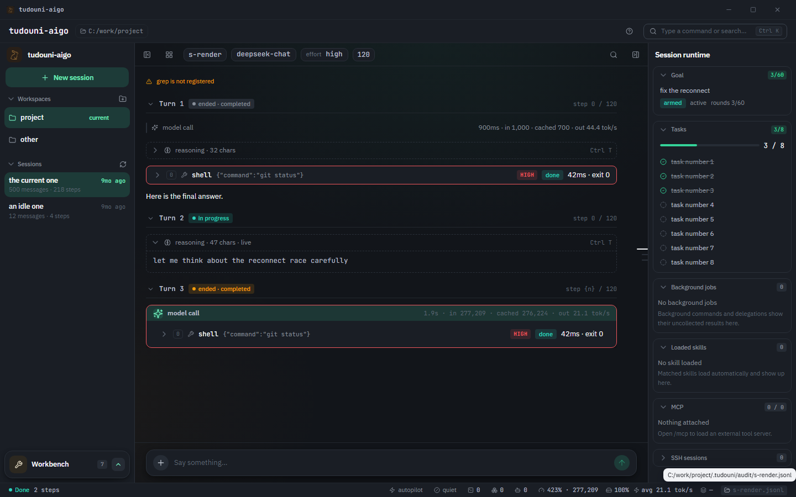

# tudouni-aigo

**tudouni-aigo** 是一个用 Go 编写的智能体运行时：模型调用工具、工具结果回给模型，循环往复，直到把事情做完。一个静态二进制，没有解释器、没有虚拟环境、没有 `_internal/` 目录，解包即用。

它从 Python + Textual 版本逐项对照重写而来（对照审查见 [docs/parity/](docs/parity/)），并在此基础上新增了桌面客户端、工作区记忆、代码智能索引等能力。



## 特性一览

- **一个二进制，四种形态**：全屏 TUI、行式 REPL、JSONL 协议端点、只读审计子命令——按需选择，而不是装四份程序。
- **工作区即边界**：模型的文件工具只能碰启动目录以内，程序拒绝在用户主目录或文件系统根启动。
- **缺配置的工具不注册**：没有 key、没有依赖的功能从 schema 里消失，而不是带着"未配置"的错误每次浪费一个来回。
- **审批 fail-closed**：中高风险工具每次询问，"允许"才可记忆，`--autopilot` 的每次放行都留审计记录。
- **会话可追溯**：会话文件追加写、上下文超限搬成工件、审计日志逐事件独立成档。
- **技能与 MCP**：SKILL.md 技能目录 + 外部 MCP 工具服务器，两者都能挂进同一个工具注册表。
- **桌面客户端**：Tauri 2 + React 独立前端，通过 JSONL stdio 协议驱动同一个 runtime。

## 快速开始

### 1. 拿到二进制

- **发布包**：解压 `dist/tudouni-aigo-<版本>-<平台>.zip`，运行 `install.ps1`（Windows）或 `install.sh`（Linux），安装器会同时留下旧命令名 `tudouni` 指向同一二进制。
- **从源码构建**：需要 Go ≥ 1.27，然后 `make build`，产物在 `dist/` 下。

### 2. 配置模型

配置只有一个来源：`~/.tudouni/config.json`。没有环境变量、没有 `.env`——一个值能在两处设置、却只在一处生效，是最难查的那种问题。首次运行找不到可用路线时程序会自动生成这个文件（模板就是仓库里的 `config.example.json`），把 `api_key` 填上即可：

```jsonc
{
  "providers": {
    "deepseek": {
      "base_url": "https://api.deepseek.com",
      "api_key": "sk-…",
      "models": [
        {"id": "deepseek-flash", "context_window": 1000000},
        {"id": "deepseek-v4-pro", "context_window": 1000000}
      ]
    }
  },
  "web": {
    "tavily_api_key": ""
  }
}
```

要点：

- **键名是路线名，顺序就是 `/model` 列表的顺序**：第一个有 key 的路线是默认模型，默认是谁是你自己排出来的。
- 不知道 `context_window` 就删掉整行，界面会显示用量但不显示百分比——错误的百分比比没有更糟，因为它会被当真。
- `web.tavily_api_key` 填了才注册 `web_search`；不填则该工具不存在，`fetch_web` 不受影响。
- **非标准端点按 `base_url` 推断协议**：以 `/messages`、`/v1/messages` 或 `/anthropic` 结尾走 Anthropic Messages 形状，以 `/responses` 结尾走 Responses 形状，其余都是 chat completions。`api_style`（`openai` / `anthropic` / `responses`）可以显式覆盖，但只在 base URL 真有歧义时才写——路径不自动调整，端点在 `/v1/messages` 时 `base_url` 就不能已以 `/v1` 结尾。
- `headers` 是给要求自报身份的网关准备的额外请求头；`${session}` 会被替换成当前会话 id，空值的头不发送。
- 思考强度：`reasoning_effort` 是模型的起始档位，`effort_levels` 是 `/effort` 提供并执行的档位菜单（全词汇：`minimal` 到 `max`）。档位**从不去线上重写**，你选什么就发什么。
- **凭证放哪由协议决定**：chat completions 与 Responses 用 `Authorization: Bearer`，Messages 形状用 `x-api-key`。给 Messages 端点手写 Bearer 的报错是"Missing API key"，而 key 其实就在请求里——这是唯一一种错因被报错指向别处的失败。

### 3. 生成图片（可选）

`image_generation` 是顶层配置段，`provider` 指向一条聊天路线以继承 key 和端点（key 只写一次），`model` 必填且永不继承：

```jsonc
"image_generation": {
  "provider": "deepseek",
  "model": "gpt-image-1"
}
```

不写这一段，`generate_image` 就不注册，其余一切照旧。生成的图片是**工作区里的真实文件**（如 `out/poster.png`），可以用 `` 展示、用 `present` 声明、用系统查看器打开。该工具是中风险，每次调用都会请求审批，且每轮最多四张——每张都花你的钱。

### 校验配置的三件套

```sh
go run ./tools/checkconfig ~/.tudouni/config.json                  # 只读解析每条路线，零成本
go run ./tools/probeconfig ~/.tudouni/config.json my-session [route]   # 每条路线发一个小请求
go run ./tools/probereachable ~/.tudouni/config.json my-session [model…]  # 问每个模型答不答应
```

`checkconfig` 打印每条路线实际会 POST 到哪个端点，改完配置先跑它。`probeconfig` 区分"请求形状错了"和"key 错了"。`probereachable` 把目录里的声明当主张而不是事实——模型可能在名录里，却因账号、地区或套餐被拒。后两个会消耗配额。

### 4. 启动

```sh
cd 你的项目目录
tudouni-aigo
```

程序**必须在项目目录里启动**，并拒绝在用户主目录或文件系统根启动：工作区是模型文件工具的活动范围，`read_file` 无需审批，"这个目录以下全是工作区"等于免审批读你的 `.ssh` 和其他项目的 `.env`。

## 使用

| 形态 | 怎么进入 |
| --- | --- |
| 全屏 TUI | 终端里裸跑 `tudouni-aigo`（默认） |
| 行式 REPL | `--cli`；或 stdin/stdout 不是终端时自动回落（`tudouni-aigo > chat.txt`、管道、CI） |
| JSONL 协议端点 | `--runtime-stdio`，桌面端/Web 前端/测试框架以子进程方式启动它 |
| 只读审计 | `--audit` 及其子命令 |

界面由终端决定而不是由 flag 决定：全屏程序往重定向文件里写的只会是转义序列，所以接上管道就自动退回行式 REPL。`--tui` 可以强制切回全屏。

其余常用参数：`--session`、`--list`、`--skills`、`--history`、`--autopilot`、`--theme`、`--quiet`、`--stream`/`--no-stream`、`--debug`、`--max-steps`。`--help` 是全量清单。

界面文案是英文；系统提示词是中文并保持中文——界面说什么不许改变模型被告知什么。

### 桌面客户端

[desktop/tudouni-aigo-desktop/](desktop/tudouni-aigo-desktop/) 是独立的 Tauri 2 + React 前端，驱动同一个 Go runtime（版本号与 runtime 各自独立）：

```sh
cd desktop/tudouni-aigo-desktop
npm install
npm run dev          # 前端开发模式
npm run installer    # 出 Windows NSIS 安装包（Go 源码有改动时先在仓库根 make release）
```

## 工具

| 类别 | 工具 |
| --- | --- |
| 文件 | `read_file`、`read_image`、`write_file`、`edit_file`、`list_files`、`present` |
| 执行 | `shell`、`shell_background`、`job_output`、`job_list`、`job_kill` |
| 检索 | `grep`（随包分发的 ripgrep）、`code_explore`（工作区代码索引） |
| Web | `web_search`、`fetch_web` |
| 记忆 | `memory_search`、`memory_get`、`memory_propose` |
| 目标 | `create_goal`、`update_goal`、`get_goal` |
| 其他 | `get_current_time`、`ask_user`、`todo_write`、`load_skill`、`generate_image`、`git_snapshot`、`subagent`、`ssh_connect` / `ssh_write` / `ssh_read` / `ssh_sessions` / `ssh_close` |

`present` 是唯一不读也不写文件的工具：它把已经存在的文件声明为本轮结果，前端据此画出卡片；路径走的是同一工作区边界，工作区之外的路径直接拒绝。

四条规则撑起整个工具系统：

1. **缺配置就不注册。** `grep` 没有 vendored ripgrep、`web_search` 没有 key、`generate_image` 没有图片路线、`load_skill` 在没有技能的工作区——每一个都从 schema 里消失，启动时一行说明原因。一个看得见却只会回答"未配置"的工具，每次被尝试都白花一个来回，还会教会模型工具会说谎。
2. **工具自报风险（low/medium/high），注册表缺声明就拒绝编译**——缺省会静默落到 low。只有 low 可以并行（parallel-safe）；会向人提问的工具永远不并行，这是两个独立的开关。
3. **审批 fail-closed。** 中、高风险每次停下询问。你回答 "always" 的内容记进工作区的 `.tudouni/permissions.json`——可审查、可提交给团队——而且这个文件只能记**允许**："拒绝"是策略的事，两个地方回答"这算不算拒绝"早晚会不一致。`--autopilot` 不问任何人，并为每次放行记录 `outcome=autopilot`，"这一轮有没有人盯着"在审计里只有一个答案。
4. **子代理不能绕审批。** `subagent` 派生的子代理跑在父注册表上、摘掉了委派工具，它自己做不了的事被拒绝而不是转发审批。它的完整 transcript 作为独立会话保存（会话列表里不显示）。

## 技能与 MCP

技能是含 `SKILL.md` 的目录，frontmatter 里的 `description` 是模型加载技能前唯一看得见的东西——这一行决定技能会不会被用。扫描优先级从低到高，个人级压过项目级（与 git config 同理）：

| 用户级（跟着人走） | 项目级（跟着工作区走） |
| --- | --- |
| `~/.skills` | `<workspace>/.skills` |
| `~/.agents/skills` | `<workspace>/.agents/skills` |
| `~/.tudouni/skills` | `<workspace>/.tudouni/skills` |

`--skills` 列出识别到的**和被跳过的**（附文件与过错）：格式坏掉的 frontmatter 在别处没有任何症状，技能只是从模型拿到的列表里消失。

MCP 只认 `~/.tudouni/mcp.json`，这是安全边界而不是不方便：`command` 是启动时执行的代码，工作区级的列表意味着 clone 一个仓库就等于运行了什么。工作区里的 `.tudouni/mcp.json` 被忽略，并在 stderr 上说明，而不是静默。

## 会话、上下文与审计

- **会话是工作区 `.tudouni/sessions/` 下的 JSONL 文件**，每个项目各自一份历史：项目 A 里的东西在项目 B 看不见。文件追加写——一轮只追加它产生的消息，保存成本是这一轮的大小，不是整个会话的大小。长期目标（Goal）也存在同一个文件里。
- **上下文超限不是丢弃，是搬走**：大的工具结果变成 `.tudouni/artifacts/<session>/` 下的工件，消息里留一个引用（大小、来源、行数），`--history` 靠索引解析。
- **审计日志是第二个 append-only 文件**，一行一个事件，协议把这些行原样转发——"审计日志即协议"在字节层面成立。`--audit` 输出汇总：模型调用、token、缓存命中率、工具结果、耗时分解、停止原因。
- **一条不可协商的不变量**：带 `tool_calls` 的 assistant 消息后面必须跟齐每个 id 的工具结果，否则会话永远发不出去（端点之后每轮 400，报错还像"上下文太长"）。所以会话只在整步之间落盘、`interrupt` 只在步间停、`shutdown` 等当前轮跑完而不是拦腰切断。

工作区终端（前端可浏览文件、可开 shell）也遵循同样的边界：真 PTY 而非管道（Unix 用 `creack/pty`，Windows 用 ConPTY），否则 `vim`、`top`、Python REPL 要么起不来要么画花；终端属于**工作区**而不是会话，切换、关闭、删除会话都不会杀终端；杀终端杀整个进程组（`shell → npm → node`）；输出是按定时与阈值聚合的异步流，在 rune 边界切断，且不进审计、不进上下文、不进工件。

## 架构

三层，箭头单向：前端只说协议、从不碰 runtime 内部；runtime 通过接口对协议说话、不知道对面是谁。

```
cmd/tudouni/          唯一入口：参数、--help/--version、子命令分发
cmd/cg/               代码智能索引的独立 CLI
internal/protocol/    JSONL 契约：codec、server、client、transport
internal/runtime/     组装：配置、权限、通知、runtime 本体、goal 驱动
internal/agent/       循环：模型调用、工具、模型调用，直到答完
internal/model/       唯一知道"一次补全长什么样"的地方
internal/imagegen/    图片生成路线与它的方言
internal/tools/       工具框架、工作区边界、全部内置工具
internal/security/    策略、闸门、命令规则、审批记忆
internal/state/       会话存储、模型目录、计数器
internal/context/     预算、降级、压缩、工件存储
internal/files/       前端侧的文件能力：file_list / file_read
internal/terminal/    工作区终端：真 PTY、聚合输出、生命周期、进程组清理
internal/memory/      工作区记忆：Markdown 事实、候选审核、确定性检索
internal/codeintel/   代码智能索引（工作区开关，默认关）
internal/skills/      技能的发现与解析
internal/mcp/         外部工具服务器的挂载
internal/subagent/    委派：子注册表、深度规则
internal/audit/       追加式审计与查看器
internal/frontends/   tui、cli、ansi
```

## 构建与发布

```sh
make build     # 本机平台，版本号编进二进制，产物在 dist/
make test      # 全量测试（沙箱里没输出时，bash test.sh 直接跑测试二进制）
make vet
make release   # 全平台构建 + 校验 + 打包 zip
```

- 全程 `CGO_ENABLED=0`：静态二进制没有 libc 要配，"解包即用"才成立。
- **版本号编译进二进制**（`-ldflags`），来源是仓库根的 `VERSION` 文件（或 `$TUDOUNI_VERSION`、`git describe`）。它不是二进制旁边的文件——文件可以比二进制新，"替换可执行文件失败、旧二进制报着新版本号"这种事发生过一次就够了。所以版本相关的改动必须走 `make build` / `make release`，不能只 `go build`。
- 发布平台只有 **windows/amd64 与 linux/amd64**，因为 `tools/vendor/rg/` 只放了这两个平台的 ripgrep。加平台先加 ripgrep，否则目标机上 `grep` 静默消失。
- `make release` 会**真的运行**刚构建的二进制：`--help`、`--version`、起一次 `--runtime-stdio`、确认启动日志里没有 `grep.missing_binary`。发布包的典型故障不是"起不来"，而是"起来了但一个功能悄悄不在"，这在源码树的测试里看不见。
- 四类文件随包走，缺一个不报错、而是缺一个功能：`prompts/`（没有它连系统提示词都没有，它的存在还是程序识别安装根的依据）、`config.example.json`、`protocol/schema/`、`tools/vendor/rg/`。

### 桌面端安装包

在 `desktop/tudouni-aigo-desktop/` 下 `npm run installer` 一条命令出 NSIS 安装包（Windows），详见该目录下的文档与 [AGENT.md](AGENT.md)。桌面端版本与 runtime 版本是两个独立的轴，不要混着升。

## 文档

| 入口 | 内容 |
| --- | --- |
| [docs/README.md](docs/README.md) | 文档总入口：每份文档今天还有没有权威 |
| [docs/spec/](docs/spec/) | 权威规格：JSONL 协议 v1 语义、TUI 设计、Responses 线格式 |
| [docs/design/](docs/design/) | 设计决策与成因（已落地的与还没做的分开标注） |
| [docs/parity/](docs/parity/) | Go 重写与 Python 原版的逐项对照审查 |
| [protocol/schema/](protocol/schema/) | 协议的 JSON Schema（形状以此为准，与 spec 打架时听 schema 的） |
| [AGENT.md](AGENT.md) | 面向改代码的人：目录表、构建测试发布、版本号约定 |
